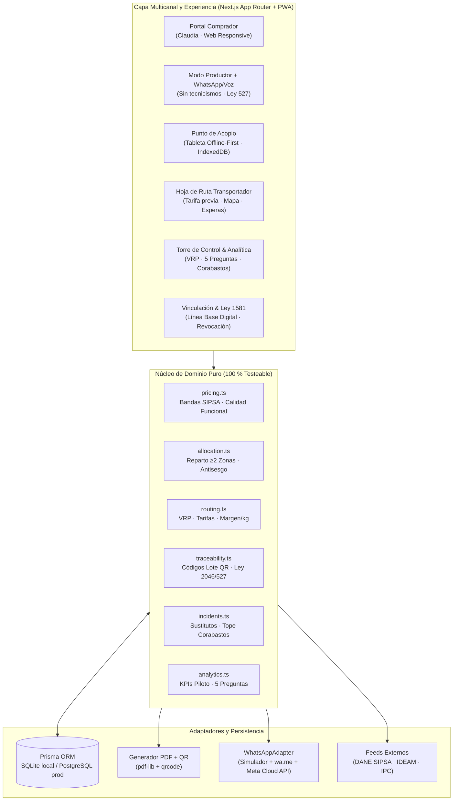
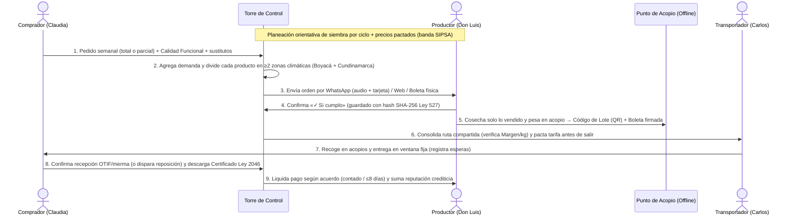

<div align="center">


<br />

[](https://nextjs.org/)
[](https://www.typescriptlang.org/)
[](https://www.prisma.io/)
[](https://tailwindcss.com/)
[](#5-módulo-de-punto-de-acopio-tableta-offline-first)
[](#calidad-y-pruebas-automatizadas)

**«Se cosecha lo que usted ya pidió.»**  
*Plataforma B2B de cosecha programada contra pedido, rutas compartidas y trazabilidad campesina que conecta asociaciones de pequeños productores de Cundinamarca y Boyacá con comedores institucionales de Bogotá.*

[Propósito y Problema](#-el-problema-y-la-evidencia-de-mercado) • [Reglas de Diseño](#-reglas-de-diseño-y-hallazgos-de-investigación) • [Arquitectura](#️-arquitectura-y-ciclo-semanal) • [Módulos](#-módulos-funcionales-y-documentos-pdf) • [Analítica](#-motores-algorítmicos-y-las-5-preguntas-analíticas) • [Instalación](#-instalación-y-arranque-rápido)

</div>

---

## 🌱 El Problema y la Evidencia de Mercado

En Colombia, la cadena de abastecimiento de frutas y verduras entre el campo y las cocinas institucionales sufre una descoordinación estructural: **el productor cosecha a ciegas sin saber si venderá ni a qué precio, mientras el comedor institucional enfrenta volatilidad de precios, mercancía incompleta y compras urgentes**.

| Indicador de contexto | Cifra verificada | Fuente |
|---|---|---|
| Alimentos disponibles perdidos o desperdiciados en Colombia | **34 %** (9,76 millones de ton/año; 62 % frutas y verduras) | DNP (2016) / MinAmbiente (2025) |
| Pérdida concentrada en finca (40,5 %) y distribución (20,6 %) | **61,1 %** del desperdicio total nacional | DNP (2016) |
| Alimentos vendidos en Bogotá que pasan por Corabastos | **> 94 %** (88 % origen regional; 42 % Cundinamarca) | Alcaldía Mayor de Bogotá (2026) |
| Variación anual de precios en restaurantes y hoteles | **9,39 %** (papa +98 % anual en oct. 2026) | Forbes Colombia (2026) |
| Cuota mínima de compra pública a pequeños productores (ACFC) | **≥ 30 %** (+10 % puntaje adicional en licitaciones) | Ley 2046 de 2020, art. 7 |
| Conectividad a internet en hogares rurales en Colombia | **56,9 %** (casi la mitad sigue sin internet fijo) | MinTIC (2026) |

**Nuestra diferencia frente a vitrinas o distribuidores tradicionales:**  
En la plaza, en Makro o en vitrinas abiertas primero se cosecha y luego se busca comprador. En **Ruta Fresca** el orden se invierte: **la siembra se orienta por ciclo de demanda, y la cosecha se programa cada semana contra pedidos confirmados y precio pactado**, sin comprar inventario ni operar flota propia (*asset-light*).

---

## 🎯 Reglas de Diseño y Hallazgos de Investigación

El diseño del software traduce directamente las lecciones de casos comparables (*Frubana, Merqueo, Agruppa, Comproagro, Fruteo y SiembraViva*) y la investigación mixta de **Fase 2** (**45 encuestas depuradas**: 11 compradores institucionales, 17 productores campesinos y 17 transportadores + **5 entrevistas semiestructuradas**):

| Regla | Evidencia empírica / lección | Implementación en Ruta Fresca |
|---|---|---|
| **R1 · Sin activos propios** | *Frubana* y *Merqueo* cerraron por costo de servir con bodegas y flota propias. | Orquestación pura entre comedores, asociaciones campesinas y transportadores aliados. |
| **R2 · Margen por kilo visible** | Sin margen de contribución por kg positivo, escalar solo acelera el cierre. | Semáforo **Go/No-Go** en vivo antes de despachar cada ruta y simulador de 4 escenarios tarifarios. |
| **R3 · Densidad por zona** | *Fruteo* demostró que crecer concentrado en una zona reduce costos logísticos. | Piloto concentrado en **Chapinero – Teusaquillo – Ciudad Universitaria** (Bogotá). |
| **R4 · Tecnología real desde el día 1** | *Agruppa* creció rápido sin tecnología operativa ni de datos. | Motores propios de asignación multi-zona, VRP, trazabilidad QR y las 5 preguntas analíticas. |
| **R5 · Comisión validada (1–4 %)** | 7/11 compradores rechazaron 8–12 % y prefirieron **1–4 %**; piloto sin barrera. | Modo **Piloto 4 semanas al 0 %** + motor configurable (**1–4 %**, híbrido con *Plan Abastecimiento* o flete compartido). |
| **R6 · Pedidos flexibles + Reposición 11/11** | 9/11 confirman todo o parte semanalmente; **11/11 exigen reposición ante faltantes**. | Pedidos semanales parciales con corte/ajuste, **Calidad Funcional (-20 %)**, sustitutos pre-acordados y respaldo en **Corabastos** con tope de sobrecosto. |
| **R7 · Inclusión multicanal y pagos claros** | 11/17 productores y 10/17 transportadores prefieren **WhatsApp/voz**; 8/17 cobran de contado. | Simulador **WhatsApp + Notas de voz**, **Boleta impresa PDF**, **Tableta Acopio Offline-First**, auditoría antisesgo digital y pagos diferenciados (*Contado / 1–3 d / ≤ 8 d*). |

---

## 🏗️ Arquitectura y Ciclo Semanal

### Arquitectura de la plataforma



### Flujo operativo semanal (6 etapas)



---

## 🧩 Módulos Funcionales y Documentos PDF

| Módulo | Ruta | Qué resuelve |
|---|---|---|
| **Landing & Acceso por Rol** | `/` · `/login` | Propuesta de valor, métricas vivas del piloto, login con sesión firmada HMAC-SHA256 y barra rápida de cambio de perfil demo. |
| **Vinculación & Ley 1581** | `/vinculacion` | Registro de compradores, productores (con **Encuesta de Línea Base Digital**: celular, smartphone, datos, señal, WhatsApp, quién maneja el teléfono) y transportadores, más bitácora auditable y **revocable** con lectura en voz alta. |
| **Portal Comprador (Claudia)** | `/comprador` | Catálogo con precio pactado por ciclo vs SIPSA, toggle de **Calidad Funcional (-15 % a -25 %)**, pedidos parciales/flexibles, «Repetir último pedido», matriz de sustitutos, recepción OTIF/merma con protocolo de faltantes y descarga de **Certificado Ley 2046**. |
| **Productor & WhatsApp Voz** | `/productor` | Interfaz con letra grande y cero tecnicismos (*pedido, cosecha, ruta, finca, asociación, cumplir*), **simulador interactivo de WhatsApp fiel a la Figura 6 del Manual de Marca** con notas de voz (síntesis TTS + grabación de micrófono + enlaces `wa.me`), evidencia **Ley 527**, planeación de siembra, historial para crédito y estado de Seguro Finagro. |
| **Punto de Acopio (Offline)** | `/acopio` | Consola tipo tableta con **simulador de corte de señal rural**, cola persistente en **`IndexedDB`**, pesaje real, inspección de calidad (*Estándar / Funcional / Rechazo con causa*), emisión de **Códigos de Lote QR**, captura asistida sin celular y sincronización idempotente. |
| **Hoja de Ruta Transportador** | `/transportador` | Tarifa total pactada antes de salir (`base + km`, `km`, `kg` o `fijo`), carga confirmada y % de ocupación, reglas visibles de compensación por **espera (> 30 min)** y **cancelación (35 %)**, mapa offline del corredor y check-in/out de paradas. |
| **Torre de Control & Analítica** | `/operaciones` | KPIs del piloto vs metas, las **5 preguntas analíticas**, auditoría antisesgo digital, motor de asignación multi-zona, planificador VRP con semáforo de margen/kg, simulador económico post-piloto, mesa de incidencias/Corabastos, monitor **SIPSA/IDEAM** y tesorería. |

### Documentos PDF reales generados dinámicamente (`pdf-lib` + `qrcode`)

1. **[Boleta de Pedido del Productor](app/src/app/api/pdf/boleta/route.ts)** (`/api/pdf/boleta`) — Replica el diseño del Manual de Marca (tabla *Producto / Le pidieron / Precio por kilo / Kilos que trajo*, fecha de entrega, punto de acopio, fecha límite de pago, firma o huella y QR Ley 527).
2. **[Certificado de Origen Campesino — Ley 2046 de 2020](app/src/app/api/pdf/certificado-ley2046/route.ts)** (`/api/pdf/certificado-ley2046`) — Soporte verificable por lote (finca, vereda, asociación, fecha de cosecha, % ACFC y QR) para operadores de comedores con contratos públicos.
3. **[Hoja de Ruta y Acuerdo de Tarifa](app/src/app/api/pdf/hoja-ruta/route.ts)** (`/api/pdf/hoja-ruta`) — Secuencia de recogidas y entregas, kilos confirmados, tarifa pactada y cláusulas escritas de espera y cancelación.
4. **[Afiche para Punto de Acopio](app/src/app/api/pdf/afiche/route.ts)** (`/api/pdf/afiche`) — Pieza de 3 pasos (*«Coseche lo que ya está vendido · Para usted es gratis»*) lista para imprimir y pegar en el salón comunal.

---

## 📊 Motores Algorítmicos y las 5 Preguntas Analíticas

El tablero en `/operaciones` responde de forma viva a las **5 preguntas analíticas** definidas en la Fase 1 y vigila los **3 riesgos prioritarios de gobierno del dato**:

1. **Descriptiva**: Demanda semanal en kilos por producto y comedor + coeficiente de variación (`CV %`).
2. **Diagnóstica**: Desglose de causas raíz de incumplimiento (*evento climático certificado, calidad rechazada en acopio, desvío por precio de plaza, falla de ruta*).
3. **Predictiva (Oferta)**: Matriz de riesgo `Zona × Producto` (`0–100`) cruzando alertas climáticas **IDEAM**, brecha de precios **SIPSA** frente a la banda pactada e historial de incidencias.
4. **Predictiva (Demanda)**: Señal temprana de retención de comedores según sus primeras semanas (frecuencia, OTIF percibido y SLA de resolución de novedades).
5. **Prescriptiva**: Recomendaciones accionables de redistribución entre zonas climáticas, consolidación de rutas para subir ocupación vehicular y transición tarifaria para garantizar margen positivo por kilo.
6. **Auditoría Antisesgo Digital**: Mide en tiempo real el `% de kilos asignados` por canal de captura (`WhatsApp audio`, `WhatsApp texto`, `Llamada`, `Boleta física`, `Web`) para garantizar que ningún productor rural quede excluido por falta de smartphone.

---

## 🎨 Identidad Visual (Manual de Marca)

| Color | Código Hex | Uso principal |
|---|---|---|
| **Verde cosecha** | `#3A9D4A` | Logotipo, botones primarios, confirmaciones e íconos del campo |
| **Grafito** | `#263238` | Encabezados, textos principales, barra operativa y fondos oscuros |
| **Amarillo maíz** | `#F4B400` | Acentos, línea punteada de ruta compartida y alertas preventivas |
| **Gris claro** | `#F2F5F0` | Fondos limpios que evocan orden en una cocina institucional |

- **Tipografía**: `Poppins` (logotipo y títulos) + `Inter` (interfaz y tablas numéricas `tabular-nums`).
- **Identidad verbal**: trato de *«usted»* claro y concreto con el comprador; lenguaje cercano y sin tecnicismos frente al productor (*pedido, cosecha, ruta, finca, asociación, cumplir*; evitando jerga como *disrupción* o *ecosistema*).

---

## 🚀 Instalación y Arranque Rápido

### Requisitos previos
- **Node.js** `>= 20` y **npm** `>= 10` (probado en Node `v26` y npm `12`).
- SQLite integrado (no requiere servidor de base de datos externo para arranque local; migrable a PostgreSQL cambiando 1 línea en `prisma/schema.prisma`).

### Paso a paso

```bash
# 1. Clonar el repositorio e ingresar a la aplicación
git clone https://github.com/SAmaldonado/RutaFresca.git
cd RutaFresca/app

# 2. Configurar variables de entorno
cp .env.example .env

# 3. Instalar dependencias
npm install

# 4. Generar cliente Prisma, crear base de datos y sembrar 4 semanas de piloto
npx prisma generate
npx prisma db push
npm run db:seed

# 5. Iniciar en modo desarrollo
npm run dev
```

Abre **[http://localhost:3000](http://localhost:3000)** en tu navegador.

### Perfiles demo pre-cargados *(contraseña para todos: `rutafresca2026`)*

> También puedes cambiar entre perfiles en 1 clic desde la barra superior **«Cambiar perfil demo»**.

| Rol | Usuario | Correo | Vista principal |
|---|---|---|---|
| **Compradora** | Claudia Morales (Comedor Andina) | `claudia@andina.com.co` | `/comprador` |
| **Productor** | Don Luis Rodríguez (Ventaquemada, Boyacá) | `luis.rodriguez@ventaquemada.org` | `/productor` |
| **Punto de Acopio** | Marta Pulido (Gestora de zona · Offline) | `acopio.ventaquemada@rutafresca.co` | `/acopio` |
| **Transportador** | Carlos Méndez (Camión liviano · WLA-482) | `carlos.mendez@rutasaliadas.co` | `/transportador` |
| **Operaciones** | Equipo Torre de Control | `ops@rutafresca.co` | `/operaciones` |

---

## ✅ Calidad y Pruebas Automatizadas

```bash
cd app

# Validación estricta de tipos TypeScript
npm run typecheck

# 11 pruebas unitarias (6 motores de dominio + 4 generadores PDF reales)
npm test

# Build de producción (26 rutas SSR + API)
npm run build

# Suite E2E completa (20 verificaciones de ciclo semanal + SSR + APIs + PDFs binarios)
node tests/e2e/full-cycle.mjs
```

---

## 📂 Estructura del Repositorio

```text
Rutafresca/
├── README.md                           # Presentación ejecutiva y técnica del proyecto
├── .gitignore
├── docs/
│   └── banner-rutafresca.svg           # Banner vectorial oficial de marca
├── Documentación/                      # Entregables académicos Fase 1 y Fase 2
│   ├── Presentacion_Ejecutiva_Ruta_Fresca_Actualizada.pdf
│   ├── Ruta_Fresca_Fase_2.pdf
│   ├── Ruta_Fresca_Informe_Encuestas.pdf
│   ├── Ruta_Fresca_Base_Depurada_Final.xlsx
│   └── ProyectoMarketing*.pdf
└── app/                                # Aplicación Full-Stack Next.js + Prisma + PWA
    ├── prisma/
    │   ├── schema.prisma               # 26 entidades relacionales + gobierno del dato
    │   └── seed.ts                     # Semilla realista de 4 semanas (W45–W48)
    ├── public/                         # Manifiesto PWA, Service Worker e ícono SVG
    ├── src/
    │   ├── domain/                     # 6 motores puros (pricing, allocation, routing, traceability, incidents, analytics)
    │   ├── adapters/                   # WhatsAppAdapter (simulador/Meta Cloud API) + PDF/QR generator
    │   ├── components/                 # BrandLogo, CorridorMap, AppShell y los 6 portales
    │   ├── lib/                        # Auth HMAC-SHA256, Prisma, IndexedDB offline queue, formateadores COP
    │   └── app/                        # Páginas App Router + 20 endpoints REST y PDFs
    └── tests/
        ├── unit/                       # Pruebas unitarias de dominio y PDFs (Vitest)
        └── e2e/                        # Prueba integral del ciclo semanal completo
```

---

## 🔌 Paso a Producción (PostgreSQL y WhatsApp Cloud API)

<details>
<summary>Ver guía rápida de despliegue productivo</summary>

1. **PostgreSQL**: en `app/prisma/schema.prisma`, cambiar `provider = "sqlite"` por `provider = "postgresql"`, configurar `DATABASE_URL` en producción y ejecutar `npx prisma migrate deploy && npm run db:seed`.
2. **WhatsApp Business Cloud API (Meta)**: definir en `.env`:
   ```env
   WHATSAPP_ADAPTER_MODE="meta_cloud_api"
   WHATSAPP_CLOUD_TOKEN="tu-token-meta"
   WHATSAPP_PHONE_NUMBER_ID="tu-phone-number-id"
   ```
3. **Seguridad en producción**: definir `NEXT_PUBLIC_ENABLE_DEMO_SWITCHER="false"` y un `AUTH_SECRET` criptográfico de 32+ bytes.

</details>

---

## 👥 Equipo y Contexto Académico

Proyecto integrador desarrollado en la **Universidad Nacional de Colombia** (*Ingeniería de Sistemas y Computación · Marketing y Gestión de Negocios Digitales basados en Datos · Noviembre de 2026*):

- **Sergio Alejandro Reita Serrano**
- **Santiago Andrés Maldonado Gahona**
- **Daniel Ferney Gómez Rojas**
- **Kevin Camilo Rojas Marín**

---

<div align="center">
<sub><b>Ruta Fresca</b> · «Sepa qué le llega, cuándo y de qué finca.»</sub>
</div>
